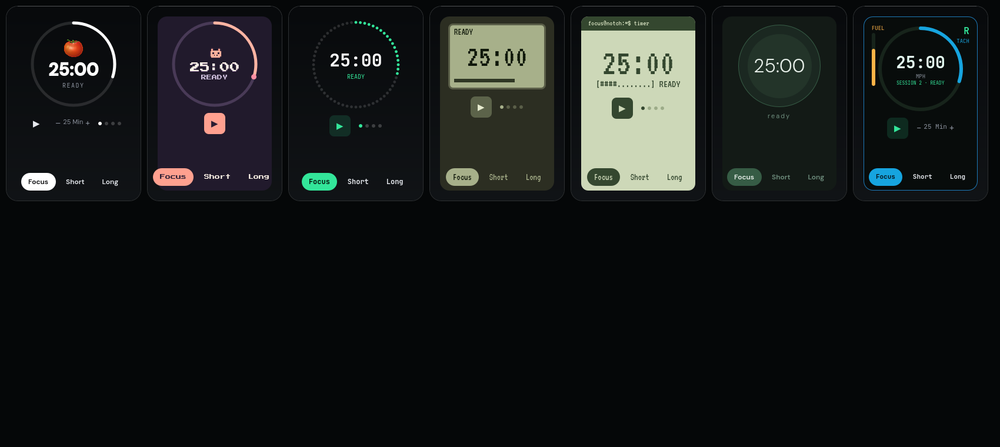
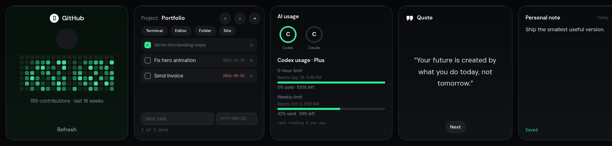

# BuildNotch for Omarchy (Hyprland)

A Linux port of [BuildNotch](https://www.buildnotch.app/): a notch at the top of the screen that opens on hover
and holds your music, focus timer, AI apps and usage, GitHub activity, projects and tasks, quote, favorite apps,
note, code playground, JSON formatter, clipboard history and file tray. See [FEATURES.md](FEATURES.md) for every
feature and its port status.

Built with [Quickshell](https://quickshell.org) (QML) as a wlr-layer-shell overlay that reserves no space. It reads
how much room a bar claims at the top of each screen (Waybar on Omarchy 3.x, Omarchy's own shell bar on 4.x) and
hangs below it, so it never covers the bar; set `topOffset` in the config to override. Quickshell gives MPRIS, the desktop-entry database, Hyprland global shortcuts and animated,
fully custom drawing in one process, which is what a pixel-faithful notch needs. It is independent of the
macOS/Windows Codenotch code in this repo.

## Install (Omarchy / Arch)

```sh
sudo pacman -S --needed quickshell qt6-svg libnotify github-cli cliphist wl-clipboard xdg-utils
gh auth login            # once, for the GitHub card
./install.sh --hypr      # to ~/.local/share/buildnotch-app and ~/.local/bin/buildnotch, plus the Hyprland lines
```

Omarchy 3.x and 4.x configure Hyprland differently, and `--hypr` picks the right one:

| Omarchy | Config | Lines to add | Files |
|---|---|---|---|
| 3.x | `.conf` | [`hyprland.conf`](hyprland.conf) | `autostart.conf`, `bindings.conf` |
| 4.x | Lua | [`hyprland.lua`](hyprland.lua) | `autostart.lua`, `bindings.lua` |

Without `--hypr` the installer only copies files; add the lines by hand. Then run `buildnotch` or log out and in.
A package is available through `cd buildnotch-omarchy && makepkg -si` (PKGBUILD, builds from the repository's
`main` branch). Uninstall with `./install.sh --uninstall` (removes the files; the autostart block, including its watcher line, and the packages stay until you remove them). Licenses of the bundled fonts, icons and the
buildnotch.app artwork are in [NOTICE.md](NOTICE.md).

The notch needs `hyprctl` (Hyprland) for global shortcuts, bar-aware placement and fullscreen hiding. Clipboard history needs `cliphist`, `wl-clipboard` and a watcher running `wl-paste --watch cliphist store`. `install.sh` installs the two packages if missing (sudo only then), starts the watcher right away if it is not running, and with `--hypr` adds it to your Hyprland autostart unless one is already configured. The `buildnotch` launcher also starts it if none is running. If the history says "Clipboard watcher not running", run that command once.

## Use

| Action | How |
|---|---|
| Open | Move the pointer to the collapsed notch or pill (Settings, General turns hover off) |
| Pin open | Click the notch or an empty part of the bar; click again to unpin |
| Toggle | `SUPER + ALT + N` (the site's `Win + \`` is Omarchy's scratchpad key on 4.5+) |
| Close | `Esc` or the Close button |
| Browse cards | Mouse wheel over the cards |
| Launch AI apps | `ALT + 1` to `6` (click the notch once so it has keyboard focus) |
| Clipboard history | Bar icon or `SUPER + ALT + V` |
| Rearrange cards | Edit, then drag a card; Done to finish |

## Config

`~/.config/buildnotch/config.json` is created on first run and rewritten by the Settings panel; edit either.
Tasks, notes and the playground are in `~/.local/share/buildnotch/data.json`, the file tray in
`~/.local/share/buildnotch/tray/`. No tokens are stored anywhere: GitHub uses your `gh` login.

### Placement

The centred notch hides the clock on bars that put it in the middle (Omarchy 4.x). `placement` moves the
collapsed notch out of the way; it always opens to the full centred panel, animating from wherever it sits and
shrinking back to the same spot. Set these in Settings, General, Placement or in `config.json`:

| Key | Default | Meaning |
|---|---|---|
| `placement` | `"offset"` | `"offset"`: the collapsed notch hangs below the bar, off centre. `"pill"`: a small rounded black pill, as tall as the bar icons, sits on the bar. |
| `offsetSide` | `"left"` | Offset mode: `"left"` or `"right"` of the screen centre. |
| `offsetX` | `260` | Offset mode: px from the screen centre to the notch centre. |
| `pillX` | `-190` | Pill mode: px from the screen centre to the pill centre; negative is left of the centre, so the default sits just left of the clock. Raise it (towards 0) or lower it if your clock is narrower or wider. |

The pill shows a tiny live hint: the playing track, else the focus timer, else a dot. Hover it, or press
`SUPER + ALT + N`, to open the panel downward; it shrinks back into the pill on close. Positions are clamped to
the screen. The pill's height follows the reserved bar height (`topOffset` overrides it, as for the notch).

### AI usage

No provider ships with a built-in network call or credential read. Each provider in Settings, AI has an optional
command that prints JSON; without one the provider shows as unavailable, never as 0% used:

```json
{ "plan": "Plus", "windows": [ { "label": "5-hour limit", "usedPercent": 12, "resetsAt": "2026-10-24T22:00:00Z" } ] }
```

## Development

`./scripts/check.sh` runs the logic tests (`node tests/lib.test.js`), validates the example config, lints QML if
`qmllint` is installed and syntax-checks the shell scripts. Run in place with `bin/buildnotch` inside Hyprland.

## Screenshots

These are offscreen renders of the real QML components with sample data (the sandbox that built this has no
Wayland session). Real on-device screenshots are still to be added.



